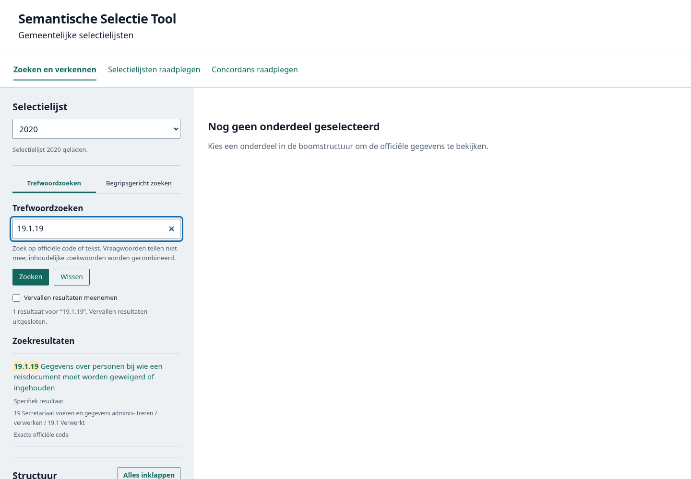
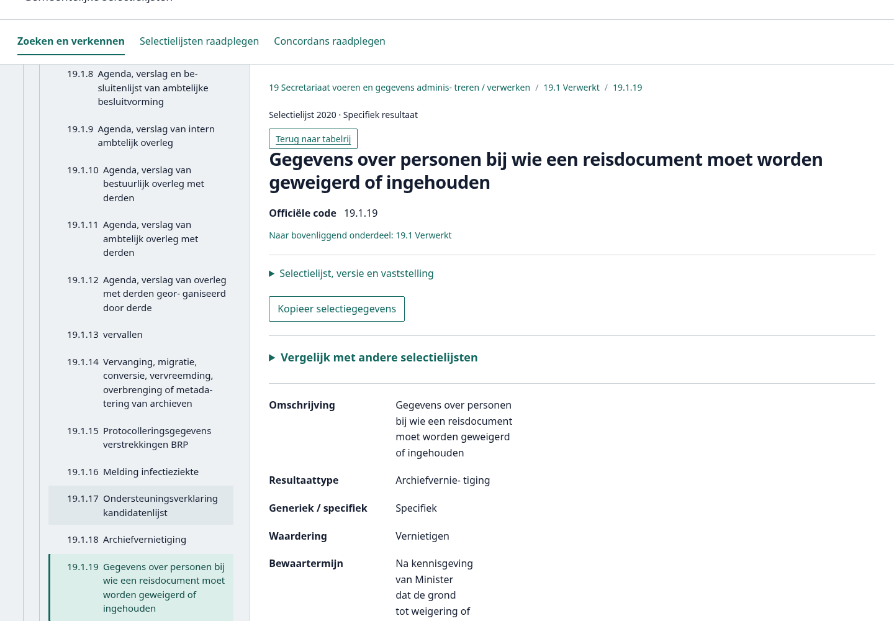
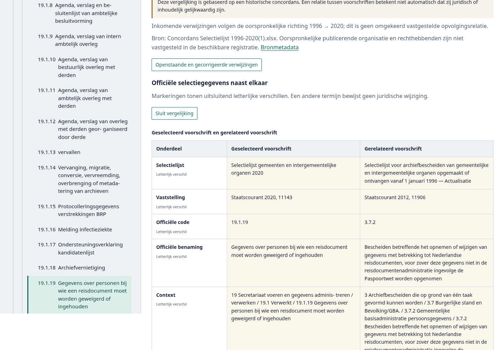
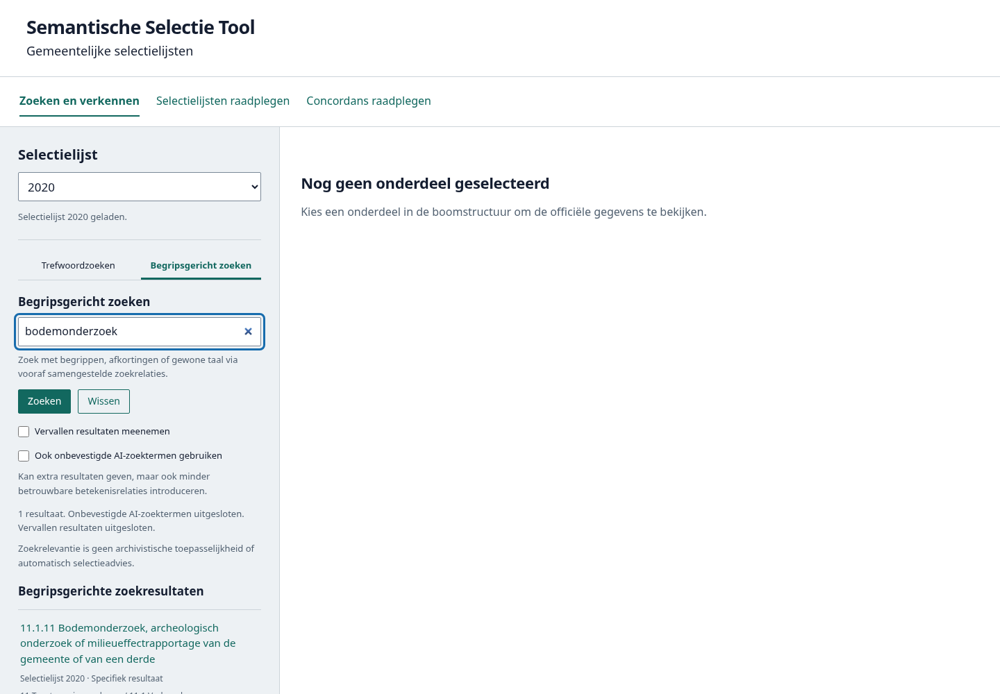
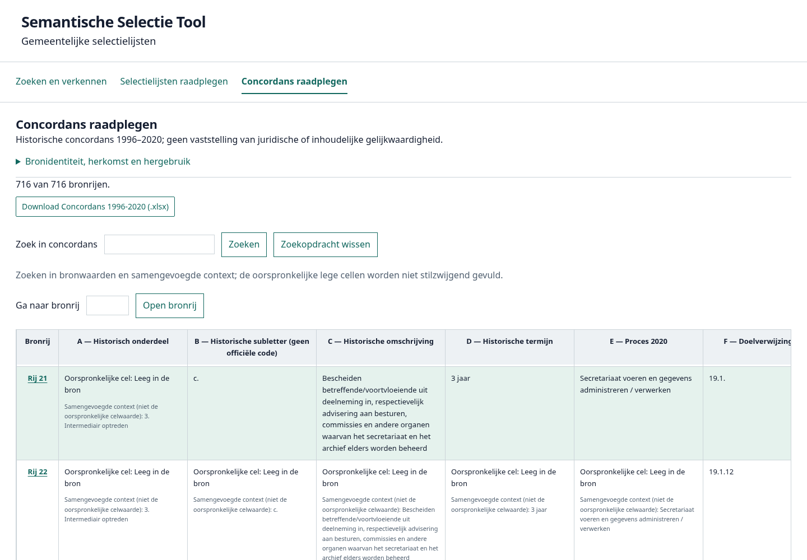
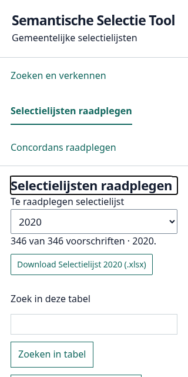
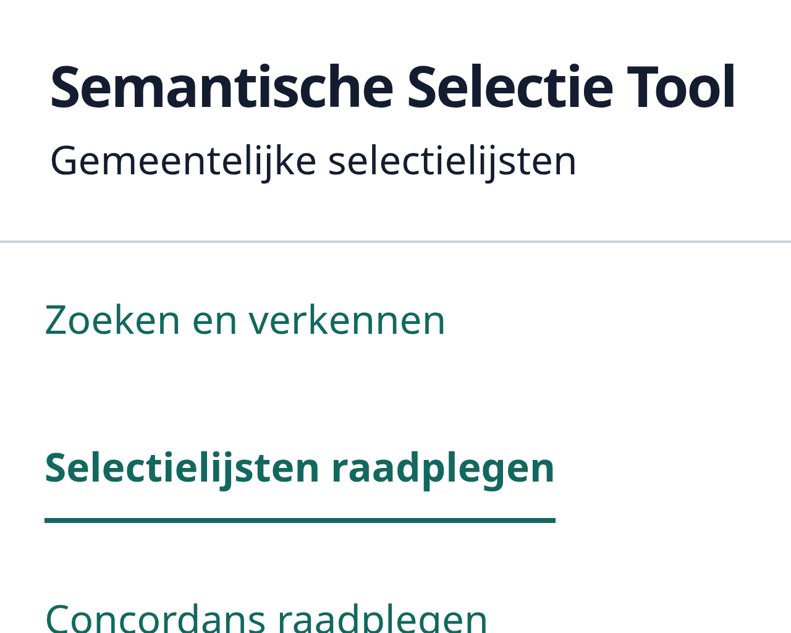
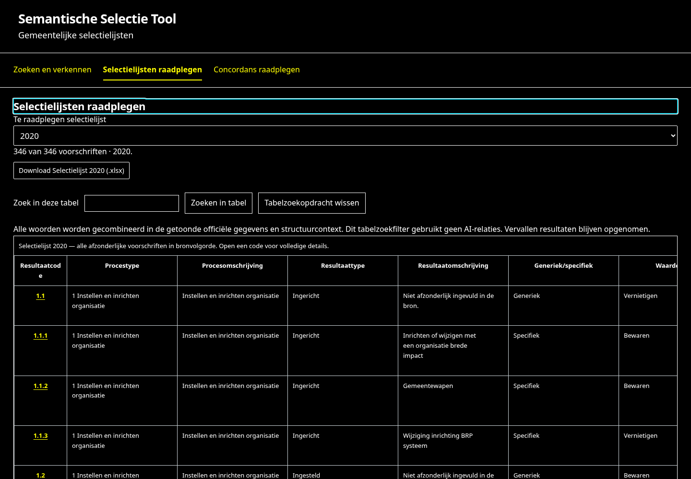
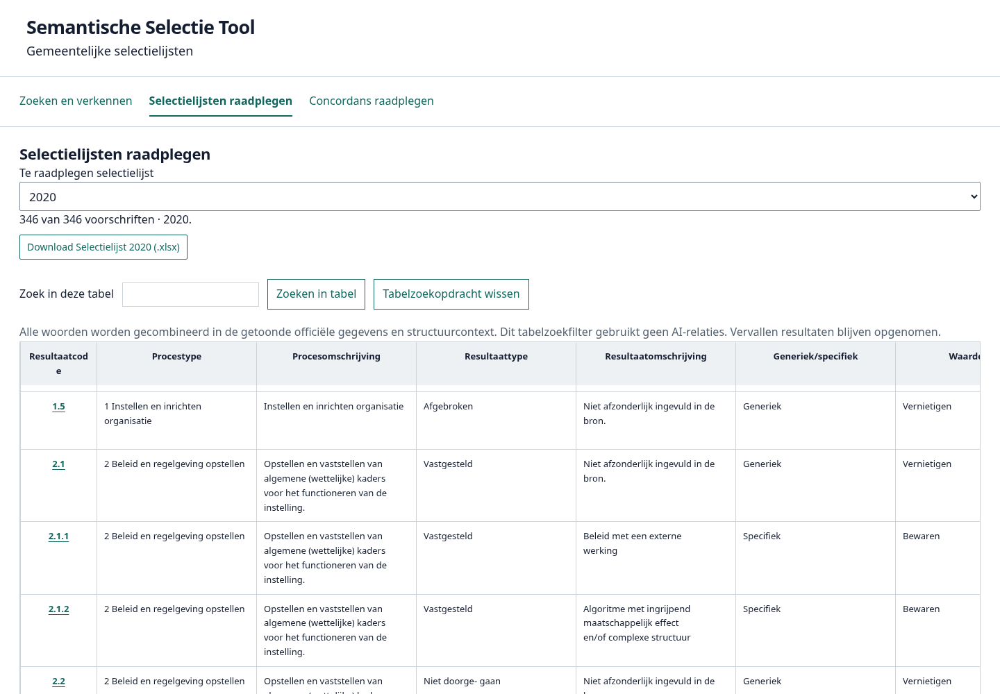

# UI/UX-, toegankelijkheids- en designaudit

## Oordeel en afbakening

Audit van **12 november 2026**, productiebron `a76eaa6` (merge PR #19), zonder concordansalias. **Niet gereed voor een claim WCAG 2.2 AA:** twee concrete P1-problemen zijn vastgesteld: onvoldoende contrast van de tabelzoekveldrand en volledig door een vaste tabelkop bedekte toetsenbordfocus. Daarnaast zijn **acht P2- en twee P3-bevindingen** geregistreerd. Dit is een steekproefaudit met alle A/AA-criteria in scope, geen onafhankelijk toegankelijkheidsonderzoek, formele conformiteitsverklaring of gebruikersonderzoek met eindgebruikers.

De functionele basis is sterk: drie herkenbare hoofdroutes, native formulieren/tabellen, een toetsenbordbedienbare ARIA-boom, zoekmodustabbladen, brongetrouwe details, afzonderlijke onzekerheden en vier werkende downloads. Geen productiecode, bronwaarde, publicatie-JSON, zoeklogica, concordansrelatie of Excel-inhoud is in deze opdracht gewijzigd. Alleen deze documentatie, actuele schermafbeeldingen en afzonderlijke audithelpers zijn toegevoegd.

Vervolgdocumenten: [designsysteem](designsysteem-voorstel.md), [thema's en contrast](themas-en-contrast.md), [verbeterroadmap](ui-ux-verbeterroadmap.md). Onderbouwende [metingen](audit-bewijs/metingen.json) en volledige [CSS-inventaris](audit-bewijs/css-inventaris.json) horen bij dit rapport.

## Methode, omgeving en bewijskracht

| Methode | Werkelijk uitgevoerd | Begrenzing |
| --- | --- | --- |
| Statische inspectie | `index.html`, volledige `style.css`, app-/routecode, boom, beide zoekpanelen, details, viewers, vergelijking, publicatielaag/export en bestaande tests | Geen bewijs van gedrag in alle browsers |
| Automatisch | axe-core **4.11.0**, Chromium **156.0.8078.79**, 10 normale schermtoestanden plus één forced-colors-toestand; WCAG 2/2.1/2.2 A/AA-tags en best practices | Geen volledige WCAG-dekking; `incomplete` vereist beoordeling |
| Gerichte interactieproeven | Tab, Shift+Tab, pijlen, Enter, zoeken, lijstwissel, tabel/detail/terug, vergelijking, scrollregio, foutmelding | Via Playwright gestuurde echte browser; geen onafhankelijke menselijke gebruikerstest |
| Visuele inspectie | Actuele opgeslagen screenshots hieronder daadwerkelijk bekeken; desktop, smal mobiel, vergelijking en systeemkleuren | Geen visusbeperking of motorische beperking gesimuleerd als gelijkwaardig aan eindgebruikersonderzoek |
| Browserzoom | Werkelijke Chromium-instelling 100/200/400%; fysiek viewport 1280×1024, CSS-breedten 1280/640/320 en DPR 1/2/4 | Geen pinchzoom of alleen smaller viewport als browserzoom gepresenteerd |
| Letter-/afstandproeven | Chrome standaardletter 16→32px; daarnaast geïsoleerde tijdelijke CSS-proeven met 32px root en WCAG-tekstafstand | CSS-proef is geen gebruikersvoorkeur; elke toestand wordt herladen om contaminatie te voorkomen |
| Schermlezer | **Niet uitgevoerd**: geen NVDA, VoiceOver, JAWS of Orca beschikbaar | DOM/ARIA-inspectie en axe zijn geen schermlezertest |
| Andere browsers | **Niet uitgevoerd**: geen Firefox/Safari beschikbaar | Geen uitspraak over volledige cross-browsercompatibiliteit |
| Downloads | Alle vier uit gewone build, onafhankelijk ZIP/OOXML teruggelezen | Geen Excel-/LibreOffice-schermlezertest |

De Browser-plugin is niet beschikbaar; de bestaande Playwright-opzet is gebruikt. De scanner is apart in een tijdelijke map opgehaald, zonder wijziging van dependencies of lockbestand. Axe-bron SHA-256: `e9e5863c33a874f09bc01acd9234b7e3c871479f5eef8802fa582544465e6d01`. Rapporten bevatten geen interne gebruikersdossiers of nieuwe persoonsgegevens.

### Automatische resultaten correct interpreteren

In de tien normale toestanden zijn **geen axe-overtredingen met WCAG-tags** gevonden; er zijn wel zeven voorkomens van de best-practiceregel `heading-order`, verdeeld over vijf toestanden. Het betreft herhaalde problemen bij zoekresultaatkoppen en de vergelijkingskop, niet zeven afzonderlijke WCAG-overtredingen. Sommige checks blijven `incomplete`; zie de meetbijlage. De twee P1's zijn gevonden met gerichte beoordeling en zouden bij alleen axe worden gemist.

De forced-colors-scan rapporteert **412 contrastmeldingen**. Visueel rendert de browser daar witte tekst en gele links op zwart; axe vergelijkt in deze configuratie onder meer de oorspronkelijke donkere auteurskleur met de geforceerde zwarte achtergrond. Deze uitkomsten zijn **niet als 412 bewezen contrastfouten** geteld. Native Windows Contrast Themes en echte ondersteunende technologie moeten dit onafhankelijk bevestigen. Zie UI-08.

## Wettelijk, technisch en aanvullend kwaliteitskader

| Laag | Toepassing voor dit project |
| --- | --- |
| Wettelijk, afhankelijk van uitgever | Wet digitale overheid en Besluit digitale toegankelijkheid overheid gelden binnen hun wettelijke institutionele scope. Een particuliere, onafhankelijke, niet-commerciële GitHub Pages-site valt daar **niet automatisch** onder omdat zij gemeentelijke informatie ontsluit. Stel de rechtspersoon, verantwoordelijkheid en eventuele publicatie namens een overheidsinstantie vast. Een overheidsopdracht/publicatieverantwoordelijkheid kan de beoordeling veranderen |
| Europees/normatief | Richtlijn (EU) 2016/2102 ziet op websites/apps van overheidsinstanties. EN 301 549 omvat meer dan alleen webcriteria, waaronder waar relevant documenten. De bekende referentie EN 301 549 V3.2.1 (2021), hoofdstuk 9, bouwt op WCAG 2.1 voort. De op de releasedatum aangewezen/geharmoniseerde versie moet officieel worden bevestigd; WCAG 2.2 vervangt die aanwijzing niet vanzelf |
| Privaat aanvullend | De European Accessibility Act (Richtlijn 2019/882; toepassing voor betrokken diensten/producten vanaf 28 juni 2025) maakt niet elke informatieve particuliere website automatisch verplicht toegankelijk. Deze tool is niet aangetoond als een daaronder vallende dienst. Andere regels, zoals redelijke aanpassingen onder de Wgbh/cz, vragen een afzonderlijke contextbeoordeling; geen algemene juridische vrijstelling geclaimd |
| Technisch projectdoel | **WCAG 2.2 A en AA, 55 criteria**, als afgesproken kwaliteitseis. WCAG 2.1 AA blijft apart relevant voor het bestaande wettelijke referentiekader. Het in 2.2 vervallen 4.1.1 wordt voor een eventuele EN/WCAG 2.1-toets afzonderlijk gecontroleerd |
| Ontwerp-/gebruikskwaliteit | 44px comfortabele raakvlakken, leesbare standaardtekst, donkere modus, eigen hoogcontrastmodus, consistente tokens en minder scrollfrictie. Niet ieder ontwerpdoel is een AA-verplichting; 2.5.8 vereist onder voorwaarden 24×24 CSS px en kent uitzonderingen |

Primaire bronnen: [Wdo](https://wetten.overheid.nl/BWBR0048156/), [Besluit](https://wetten.overheid.nl/BWBR0040936/), [Richtlijn 2016/2102](https://eur-lex.europa.eu/eli/dir/2016/2102/oj), [EN 301 549 V3.2.1](https://www.etsi.org/deliver/etsi_en/301500_301599/301549/03.02.01_60/en_301549v030201p.pdf), [WCAG 2.1](https://www.w3.org/TR/WCAG21/), [WCAG 2.2](https://www.w3.org/TR/WCAG22/), [EAA](https://eur-lex.europa.eu/eli/dir/2019/882/oj).

Verificatiegrens: genoemde overheids-/ETSI-/TR-webpagina's waren via de omgevingsproxy niet opnieuw toegankelijk (403). Er wordt geen actuele juridische aanwijzing als gelezen geclaimd. Wel daadwerkelijk gelezen: de officiële W3C-[brontekst](https://github.com/w3c/wcag/tree/c9ea04d4f3702e92249997c11fd678777f9c03ae/guidelines) van alle relevante criteria, en NL Design System-[documentatie](https://github.com/nl-design-system/documentatie/tree/7205379f7fd56848d5f04c261d954046d649ca7e/docs), onder meer niet-tekstcontrast en design tokens. Deze ontwikkelbronnen vervangen geen juridische verificatie van de actuele wettelijke aanwijzing. Laat de wettelijke scope vóór release door de verantwoordelijke uitgever bevestigen.

## Bevindingenregister

### UI-01 — P1 — Zoekveldrand onvoldoende zichtbaar

- **Onderdeel/bestanden:** tabelzoekvelden selectielijsten en concordans, plus bronrij-invoer; [`style.css`](../src/interface/style.css), `.viewer-bediening input` en `--lijn`.
- **Bewijs:** open `#lijst=2020`, laat het veld leeg en ongefocust. Computed border `rgb(204,212,217)` op witte invoer én witte omgeving: **1,50:1**. Er is geen andere contrasterende veldgrens. Screenshot [mobiel](audit-bewijs/09-formaat-320x640.png).
- **Criterium/gevolg:** WCAG **1.4.11 AA**; gebruikers met laag zicht kunnen het invoergebied onvoldoende onderscheiden. De gefocuste blauwe outline lost de ontbrekende ongefocuste grens niet op.
- **Voorstel:** aparte semantische control-border-token, minimaal 3:1 tegen aangrenzende kleuren; decoratieve lijnen mogen lichter blijven.
- **Impact/verificatie:** alleen presentatie, geen tekstwijziging. Meet randcontrast in alle thema's/staten en beoordeel ook de nummerinvoer.

### UI-02 — P1 — Toetsenbordfocus volledig achter vaste tabelkop

- **Onderdeel/bestanden:** doorlopende tabellen; `style.css` `.viewer-tabel thead th`, z-index en scrollregio; viewers in [`selectielijsten-viewer.ts`](../src/interface/selectielijsten-viewer.ts) en [`concordans-viewer.ts`](../src/interface/concordans-viewer.ts).
- **Reproductie:** open 2020-tabel op 1440×1000; focus link op gegevensrij-index 25, ga met Shift+Tab terug door de codes. De probe stopt bij **1.4**: focusrect y≈492,5–510,5; zichtbare sticky-kop eindigt op y≈555,2. De link is volledig door auteursinhoud bedekt. Zie [screenshot](audit-bewijs/17-focus-achter-tabelkop.png), meetbijlage en `scripts/audit/focus.mjs`.
- **Criterium/gevolg:** **2.4.11 AA**; iemand kan niet zien waar de bediening zich bevindt. Het element is technisch gefocust en de volgende Enter kan een onzichtbare rij openen.
- **Voorstel:** focusbewuste scrollruimte onder dynamische kophoogte en robuuste focus-scrollcorrectie, ook horizontaal onder de vaste eerste kolom. Geen vaste magische 65px als algemene oplossing.
- **Impact/verificatie:** toetsenbord-/scrollgedrag; rij-IDs en bronvolgorde behouden. Test Tab én Shift+Tab, hoge koppen, alle vier tabellen, 200/400%, mobiel en forced colors; focus mag nooit volledig bedekt zijn.

### UI-03 — P2 — Koppenstructuur niet consequent

- **Onderdeel/bestanden:** `zoeken.ts`, `begripszoeken.ts`, `concordans.ts`; koppen in zoekresultaten en vergelijking.
- **Bewijs:** axe `heading-order` bij `#zoekresultatenkop`, `#begripsresultatenkop` en `.concordans-vergelijking > h4`; [zoeken](audit-bewijs/02-codezoeken.png), [vergelijking](audit-bewijs/05-vergelijking.png).
- **Gevolg/criteria:** kopnavigatie kan minder voorspelbaar zijn. Raakt beoordeling **1.3.1 / 2.4.6**; een overgeslagen niveau is niet op zichzelf automatisch een bewezen AA-fout.
- **Voorstel:** vooraf een documentoutline per hoofdroute bepalen; niveau op betekenis baseren, uiterlijk via klassen. Geen bronbenamingen aanpassen.
- **Impact/verificatie:** semantische tags veranderen; labels, broninhoud en routes gelijk. Axe herhalen en kopnavigatie in een echte schermlezer testen.

### UI-04 — P2 — Zoekresultaat en tabelrij hanteren verschillende focus- en routecontracten

- **Onderdeel/bestanden:** `app.ts` `selecteer`/`navigeer`, `boom.ts`, beide zoekpanelen.
- **Bewijs:** Enter op zoekresultaat `19.1.19` zet focus op de bijbehorende `LI[role=treeitem]`, hash blijft leeg. Dezelfde rij vanuit de tabel zet focus op `H2#detailtitel` en een stabiele `#selectie=…`-URL. Een aanvullende proef start op `#selectie=2020%3A19.1`, opent zoekresultaat `19.1.19` en houdt de **oude URL naar 19.1**. Een gedeelde/herladen link kan daardoor een ander voorschrift openen dan het zichtbare detail. Terug naar tabelrij bewaart gelukkig filter `19.1.19` en focus op de rijlink.
- **Gevolg/criteria:** onverwachte sprong naar de boom en minder bruikbare geschiedenis; risico voor oriëntatie/**2.4.3** en een bevestigd niet-meeveranderende permalink; geen afzonderlijke AA-fout bewezen.
- **Voorstel:** expliciet contract: pijlen verkennen de boom zonder focusroof; activeren van resultaat/rij opent details met passende focus en deelbare route. Terugnavigatie herstelt broncontext. Toets dit eerst met gebruikers.
- **Impact/verificatie:** navigatie/focus, geen zoekrangschikking. Herhaal beide zoekmodi, boom, tabel, vergelijking en Back/Forward met AT.

### UI-05 — P2 — Te veel vaste tekstmaten; gebruikerslettervoorkeur wordt genegeerd

- **Onderdeel/bestanden:** `style.css`; basisregel en formulieren.
- **Bewijs:** **16 verschillende px-lettergroottes (11–29px)**, zes regelhoogtes, vier gewichten. Viewerinput computed 13,333px met UA-invoerfont; nabije knop 16px en dropdown 17px. Chrome standaardletter 16→32px laat root/body 16px en h1 27px. Met echte paginazoom is vergroten wel mogelijk.
- **Gevolg/criteria:** kleine broncontext en inconsistente bediening; relevant voor **1.4.4**, maar hier geen aparte schending daarvan geclaimd omdat paginazoom werkt.
- **Voorstel:** root op gebruikersstandaard, beperkte rem-schaal, inputs `font: inherit`, consistente regels en hoogtes; belangrijke inhoud niet in 11/12px.
- **Impact/verificatie:** afmetingen/omloop, geen bronherformattering. Controleer echte standaardlettervoorkeur, zoom, tekstafstand en lange labels opnieuw.

### UI-06 — P2 — Meerdere scrollgebieden maken mobiel raadplegen omslachtig

- **Onderdeel/bestanden:** `style.css`, `.boomgebied`, `.zoekresultaten ol`, `.viewer-tabelgebied`; beide viewers.
- **Bewijs:** vaste 530px hoge tabelregio naast volledige pagina-scroll; mobiele boom 40vh, zoekresultaten weer eigen 300px. Op 320×640 nemen kop, navigatie en bediening het eerste scherm grotendeels in. Geen pagina-overloop gevonden; horizontale tabel-scroll werkt met pijlen na focus.
- **Gevolg/criteria:** focus-/scrolloriëntatie en veel verticale handelingen; **1.4.10** blijft voor tweedimensionale tabellen een uitzondering toestaan. Geen automatische reflow-fout afgeleid uit een brede tabel.
- **Voorstel:** duidelijke scrollhint/instructie, inhoudsafhankelijke regiohoogte en compactere app-bediening; detailroute als verticaal leesalternatief behouden. Geen paginering of ongecontroleerde virtualisatie invoeren.
- **Impact/verificatie:** layout/scroll; alle records blijven aanwezig. Mobiel, landscape, zoom, muiswiel en toetsenbord testen, inclusief UI-02.

### UI-07 — P2 — Officiële kerngegevens worden door vergelijking naar beneden gedrukt

- **Onderdeel/bestanden:** `app.ts` voegt historische relaties vóór `.gegevens` in; `details.ts`, `concordans.ts`.
- **Bewijs:** bij `2020:19.1.19` staan teruglink, titel, versie, kopiëren en vergelijking vóór waardering/termijn. Uitklappen voegt waarschuwingen, herkomst en vergelijking toe vóór de volledige bronvelden; [details](audit-bewijs/03-details.png) en [vergelijking](audit-bewijs/05-vergelijking.png).
- **Gevolg:** officiële selectiegegevens worden lastiger te vinden; incidentele gebruiker kan historische context voorrang geven. UX-probleem, geen bewezen WCAG-fout.
- **Voorstel:** officiële kerngegevens voorop, daarna voorwaarden/bronnen, daarna historische vergelijking; herhaalde app-uitleg compact en herkenbaar apart. Bronannotaties en onzekerheden niet wegwerken.
- **Impact/verificatie:** presentatievolgorde en koppen; gegevens blijven volledig, letterlijk en onderscheidbaar. Controleer leesvolgorde, kopieertekst en vergelijkingsroutes.

### UI-08 — P2 — Systeemcontrast verliest visuele rijselectie

- **Onderdeel/bestanden:** `style.css` geselecteerde rijen/boom, hardcoded wit, box-shadow; beide viewers.
- **Bewijs:** onder geëmuleerde forced colors verdwijnt het lichtgroene onderscheid van rij 21; geselecteerde en gewone rij verschijnen met dezelfde witte ondergrond, de shadow is `none`. Tekst/links en randen blijven zichtbaar; `aria-current` blijft aanwezig. [Systeemkleuren](audit-bewijs/14-forced-colors.png).
- **Gevolg/criteria:** visuele oriëntatie bij systeemthema's; relevant voor **1.4.1 / 1.4.11**, nog geen aparte overtreding bewezen zonder Windows/AT-beoordeling. De actuele rijdetailkop geeft daarnaast tekstuele context.
- **Voorstel:** eigen niet-kleurafhankelijk selectieteken/rand, systeemkleuren en `forced-color-adjust:auto`; native systeemcontrast niet vervangen door eigen thema.
- **Impact/verificatie:** selectiepresentatie; geen nieuwe selectie of relatie. Windows Contrast Themes én AT testen; 412 axe-meldingen niet blind als productfouten behandelen.

### UI-09 — P2 — Essentiële onafhankelijke releasevalidatie ontbreekt

- **Onderdeel/bestanden:** testdekking `tests/browser/`, documentatie; alle routes en exports.
- **Bewijs:** alleen Chromium beschikbaar, geen daadwerkelijke schermlezer en geen toegankelijkheidstest in Excel/LibreOffice. ARIA-boom, mobiele vergelijking met CSS-grid en statusmeldingen zijn technisch geïnspecteerd, niet met die combinaties bewezen.
- **Gevolg:** onbekende AT-/browserproblemen kunnen onopgemerkt blijven. Dit is een **bevestigde bewijslacune**, geen verzonnen productdefect of normschending.
- **Voorstel:** NVDA+Firefox/Chrome, VoiceOver+Safari/iOS, Windows Contrast Themes en XLSX met Office-AT laten toetsen; juridische scope en normversie bevestigen.
- **Impact/verificatie:** geen functionaliteitswijziging vereist voor de toets. Vastgelegde testversies, uitkomsten en hercontrole per gevonden probleem.

### UI-10 — P2 — Visuele regels zijn niet duurzaam getokeniseerd

- **Onderdeel/bestanden:** volledige `style.css`.
- **Bewijs:** vier custom properties tegenover 23 verschillende hex-notaties plus kleurwoorden; veel afzonderlijke padding-/gapregels, herhaalde mediaqueries en componentvarianten. H1 27px, detailtitel 29px, h2 22px maar route-/componentoverrides 17–26px. Zie CSS-inventaris.
- **Gevolg:** contrast- of themaverbeteringen kunnen per component verschillen; handmatige regressies worden duurder. Onderhouds-/ontwerpkwaliteit, geen zelfstandige WCAG-fout.
- **Voorstel:** kleine semantische tokenlaag met componentcontracten voor knoppen, invoer, disclosure, tabs, boom, tabel, details en meldingen; geen zwaar framework.
- **Impact/verificatie:** CSS-migratie gefaseerd, geen DOM-rewrite zonder reden. Visuele regressies en bronintegriteitschecks per component.

### UI-11 — P3 — Donker/hoog contrast en voorkeurbeheer zijn nog geen productfunctie

- **Onderdeel/bestanden:** `style.css`, `index.html`; geen themavoorkeurcode.
- **Bewijs:** `prefers-color-scheme: dark` laat de witte standaardweergave intact; geen themaschakelaar of opslag. Native forced colors werkt gedeeltelijk via browsermapping.
- **Gevolg:** optioneel comfort ontbreekt; geen algemene WCAG-AA-plicht om een donkere modus of eigen hoogcontrastmodus aan te bieden.
- **Voorstel:** het [themaplan](themas-en-contrast.md) uitvoeren ná basisherstel; systeem/licht/donker/hoog contrast, fouttolerante lokale opslag.
- **Impact/verificatie:** nieuwe optionele instelling in een vervolgopdracht, niet in deze audit. Volledige themamatrix en geen onleesbare laadflits.

### UI-12 — P3 — Uniforme kolombreedtes veroorzaken onrustige kop-/codeafbreking

- **Onderdeel/bestanden:** `style.css` `.viewer-tabel`, eerste kolom 75/110px, overige 230px.
- **Bewijs:** “Resultaatcode” breekt op desktop als “Resultaatcod / e”, terwijl andere velden veel ruimte nodig hebben; ook bij systeemkleuren zichtbaar. Geen bronwaarde ontbreekt.
- **Gevolg:** minder rustige scannbaarheid; geen aangetoonde AA-fout.
- **Voorstel:** semantische breedtes voor code/status versus omschrijving; visueel afbreken verbeteren met CSS, geen codes of tekst aanpassen. Eventueel comfortabele/compacte dichtheid later onderzoeken.
- **Impact/verificatie:** uitsluitend kolomlayout. Lange officiële codes, samengevoegde context, 400% en sticky focus hercontroleren.

## Routes en gebruikservaring

Handelingen zijn geteld als doelgerichte acties vanaf de beschreven toestand; geen statistiek over gemiddelde echte gebruikers. Tabstappen of scrollen kunnen extra acties vragen. Stappen 1–10 zijn daadwerkelijk in de browser uitgevoerd; stap 11 is uitsluitend ontwerpbeoordeling, want er is geen schakelaar geïmplementeerd.

| Stap/scenario | Route en minimaal waargenomen handelingen | Oordeel en vereenvoudiging |
| --- | --- | --- |
| 1 Bekende code | Start → lijst kiezen → code invoeren → Enter → resultaat activeren (4 acties) | Vindbaar, exacte treffer; UI-04 focus/URL verduidelijken |
| 2 Inhoudelijk begrip | Lijst kiezen → begripsmodus → “bodemonderzoek” → Enter → resultaat (5) | Modus en onzekerheidsoptie duidelijk, standaard AI uit; kleine uitleg UI-05 |
| 3 Boom verkennen | Lijst → focus boom → Rechts → Omlaag → Enter | ARIA-niveaus, pijlen en roving tabstop aanwezig; eigen scrollregio vraagt oriëntatie |
| 4 Voorwaarden lezen | Detail openen → relevante disclosure openen; bronlocaties apart | Bron en annotatie herkenbaar; UI-07 kerngegevens eerder plaatsen |
| 5 Terug tabel | Geactiveerde tabelrij → detail → “Terug naar tabelrij” (2 vanaf tabel) | Filter “19.1.19” en linkfocus hersteld; sterk bestaand gedrag behouden |
| 6 Concordans | Hoofdnavigatie → zoeken of bronrij invoeren → Enter | Alle 716 aanwezig, bron/mergecontext onderscheiden; UI-01/02/06 |
| 7 Historisch vergelijken | Detail → historische relaties → vergelijking (2 vanaf detail) | Richting en onzekerheden expliciet; lange weergave en kopniveau UI-03/07 |
| 8 Excel | Hoofdroute → lijst (indien nodig) → download | Vier echte bestanden; laad-/gereedstatus aanwezig. Office-AT nog niet onderzocht |
| 9 Lijstwissel | Dropdown kiezen | Scheiding en cache werken, oude selectie verdwijnt; status geeft nieuwe lijst |
| 10 Toetsenbord/AT | Skiplink, Tab/Shift+Tab, pijlen, Enter uitgevoerd | Focus achter tabelkop P1. Echte schermlezer **niet** uitgevoerd |
| 11 Thema's | Voorgesteld: één instelling met vier waarden | Alleen adviserend beoordeeld; zie themaplan, geen functionele testclaim |

## Responsiviteit, tekst en robuustheid

- **320×640, 390×844, 768×1024, 844×390 landscape, 1440×1000 en 1920×1080:** tabelroutes zonder documentbrede overloop; mobiel detail eveneens op 320px gecontroleerd. Brede tabellen scrollen lokaal; geen paginering.
- **Echte 200/400%-zoom:** 1280px wordt 640/320 CSS px; geen horizontale pagina-overloop op 2020-tabel; filteren naar één rij, Enter naar detail en focus op de detailtitel werken op alle drie zoomniveaus zonder documentoverloop. Dit is een steekproef, niet iedere route/status op ieder zoomniveau. [400%](audit-bewijs/zoom-400.png).
- **Tekstafstand:** regelafstand 1,5; letterafstand .12em; woordafstand .16em; paragraafafstand 2em in tijdelijke CSS. Op de onderzochte tabel geen informatieverlies/overlap gezien. Runtime-injectie wordt na reload verwijderd; officiële bronwaarden blijven letterlijk.
- **Standaardletter 32px:** browservoorkeur bevestigd, app grotendeels onveranderd; UI-05. Een aparte gedwongen root-32px-proef is niet verward met dat gebruikersgedrag.
- **Fout en vertraging:** ontbrekende 2017-publicatie geeft begrijpelijke fout + opnieuw proberen. Bestaande browserregressies testen late antwoorden na lijst-/routewissels, ontbrekende data, cache en geschiedenis. Geen nieuwe race aangetoond; geen bewijs dat elke mogelijke fout is uitgesloten.
- **Prestaties:** in een sessie zonder axe, na tabel/detailroutes en met concordans open: circa 30.342 DOM-elementen en 8,6 MB JS-heap na expliciete GC. Dit is een lokale momentopname, geen mobiel budget, CPU-benchmark of bewijs tegen geheugenlekken. Axe-instrumentatie liep veel hoger op en wordt niet aan de app alleen toegeschreven. Meet op echte goedkope telefoons vóór optimaliseren; geen paginering als snelle oplossing.
- **Downloads:** gewone productiecontrole geslaagd voor 716/494/305/346 rijen, exacte vier namen, juiste bladen en alle primaire cellen; zoekfilter beperkt export niet. Geen backend of netwerkdienst vereist buiten statische bestanden.

## Alle 55 WCAG 2.2 A/AA-criteria: scope en resultaat

Legenda: **G** = in de genoemde steekproef geen probleem gezien, niet integraal conform verklaard; **F** = bevestigd probleem; **V** = aanvullende handmatige/AT-verificatie vereist; **N** = niet van toepassing in de onderzochte app. Automatische controles en code-inspectie zijn nergens als echte schermlezertest benoemd.

| SC | Niveau | Uitkomst | Bewijs / grens |
| --- | --- | --- | --- |
| 1.1.1 Niet-tekstuele content | A | G | Boompijl decoratief `aria-hidden`; tekstlabels aanwezig, geen inhoudelijke afbeeldingen gevonden |
| 1.2.1 Alleen audio/video vooraf | A | N | Geen media |
| 1.2.2 Ondertitels vooraf | A | N | Geen media |
| 1.2.3 Audiodescriptie/media-alternatief | A | N | Geen media |
| 1.2.4 Ondertitels live | AA | N | Geen live media |
| 1.2.5 Audiodescriptie vooraf | AA | N | Geen media |
| 1.3.1 Info en relaties | A | V | Native tabel/caption/scope/dl; koppen UI-03, mobiele vergelijking met AT toetsen |
| 1.3.2 Betekenisvolle volgorde | A | V | DOM-volgorde geïnspecteerd, kerngegevensvolgorde UI-07; AT-leesvolgorde nog toetsen |
| 1.3.3 Zintuiglijke eigenschappen | A | G | Labels niet afhankelijk van alleen positie/vorm |
| 1.3.4 Oriëntatie | AA | G | Landscape 844×390; geen oriëntatieblokkade |
| 1.3.5 Doel invoervelden | AA | N | Geen invoer van gebruikerspersoonsgegevens uit de normlijst |
| 1.4.1 Kleurgebruik | A | V | Tabs ook onderlijnd/vet; verschiltekst aanwezig. Systeemselectie UI-08 |
| 1.4.2 Geluidsbediening | A | N | Geen geluid |
| 1.4.3 Contrast minimum | AA | G | Normale axe-steekproeven + kleurparen; forced-colors-artefact niet als fout geteld |
| 1.4.4 Tekst vergroten | AA | G | Echte 200%-zoom tabel; UI-05 standaardlettervoorkeur apart verbeteren |
| 1.4.5 Afbeeldingen van tekst | AA | N | Productie gebruikt tekst, geen tekstafbeeldingen |
| 1.4.10 Reflow | AA | G | 320px en echte 400%; lokale 2D-tabellen mogen breder zijn, overige routes verder toetsen |
| 1.4.11 Niet-tekstcontrast | AA | **F** | UI-01, 1,50:1 ongefocuste veldrand |
| 1.4.12 Tekstafstand | AA | G | Tijdelijke voorgeschreven afstandsproef zonder geconstateerd verlies op tabel |
| 1.4.13 Content bij hover/focus | AA | N | Geen eigen hover-popovers/tooltips gevonden |
| 2.1.1 Toetsenbord | A | G | Boom, tabs, zoeken, details, lokale tabel-scroll en downloads bereikbaar |
| 2.1.2 Geen toetsenbordval | A | G | Uit de onderzochte regio's te tabben; geen modale vallen |
| 2.1.4 Enkelteken-sneltoetsen | A | N | Geen globale lettersneltoetsen |
| 2.2.1 Timing aanpasbaar | A | N | Geen gebruikerstijdslimiet |
| 2.2.2 Pauze/stop/verberg | A | N | Geen automatisch bewegende/verversende inhoud; datalading is gebruikersgestuurd |
| 2.3.1 Drie flitsen | A | N | Geen flitsende effecten aangetroffen |
| 2.4.1 Blokken overslaan | A | G | Skiplink naar detail of actieve viewer, getest; labels/AT verder toetsen |
| 2.4.2 Paginatitel | A | G | Betekenisvolle tooltitel; dynamische taaktoevoeging kan oriënteren |
| 2.4.3 Focusvolgorde | A | V | Normale Tabvolgorde, maar activeringsverschil UI-04 met gebruikers toetsen |
| 2.4.4 Linkdoel in context | A | G | Rijlabels, code+omschrijving, bronlinks; AT-steekproef nog nodig |
| 2.4.5 Meerdere manieren | AA | G | Boom, zoekmethoden en tabellen; drie hoofdroutes |
| 2.4.6 Koppen en labels | AA | V | Labels beschrijvend; outline UI-03 en AT-toets nodig |
| 2.4.7 Focus zichtbaar | AA | V | Outlines aanwezig; zichtbaarheid in alle staten/kleuren en UI-02 hercontroleren |
| 2.4.11 Focus niet bedekt minimum | AA | **F** | UI-02: volledige bedekking achter sticky kop bewezen |
| 2.5.1 Aanwijzergebaren | A | N | Geen eigen meerpunts-/padgebaren; normaal scrollen is browsergedrag |
| 2.5.2 Aanwijzerannulering | A | G | Activatie via click; geen eigen down-only-acties gevonden |
| 2.5.3 Label in naam | A | G | Tekstknoppen en rij-aria-labels bevatten zichtbare code/tekst |
| 2.5.4 Bewegingsbediening | A | N | Geen bewegingssensorbediening |
| 2.5.7 Sleepbewegingen | AA | N | Geen eigen drag-acties |
| 2.5.8 Doelgrootte minimum | AA | V | Kleine inline-/rijlinks en spacing-uitzonderingen meenemen; geen 44px-AA-eis verzonnen |
| 3.1.1 Taal pagina | A | G | `lang="nl"` |
| 3.1.2 Taal onderdelen | AA | V | Nederlandse UI; oorspronkelijke buitenlandse termen/citaten volgens uitzonderingen apart beoordelen, niet redigeren |
| 3.2.1 Bij focus | A | G | Focus alleen opent geen nieuw hoofdscherm |
| 3.2.2 Bij invoer | A | G | Lijstkeuze verandert verwachte lijst; zoeken vereist Enter/knop |
| 3.2.3 Consistente navigatie | AA | G | Hoofdroutes consistent aanwezig |
| 3.2.4 Consistente identificatie | AA | G | Gelijksoortige functies hebben herkenbare labels; visuele verschillen UI-10 |
| 3.2.6 Consistente hulp | A | N | Geen contact-/hulpmechanismen die onder dit criterium vallen aangetroffen; vereist niet zelf een helpfunctie |
| 3.3.1 Foutidentificatie | A | G | Beschrijvende meldingen voor laden/ongeldige verwijzing; invoer bronrij native validatie |
| 3.3.2 Labels/instructies | A | G | Zoek-/lijst-/rijlabels en hulptekst aanwezig |
| 3.3.3 Foutsuggestie | AA | G | Opnieuw proberen/kies lijst/wis zoekvraag; geen raadselachtige standaardbronwaarden |
| 3.3.4 Foutpreventie juridisch/financieel/data | AA | N | Geen bindende transacties of wijziging gebruikersgegevens |
| 3.3.7 Overbodige invoer | A | N | Geen verplicht meerstapsgegevensproces; zoekcontext verbeteren blijft UX |
| 3.3.8 Toegankelijke authenticatie minimum | AA | N | Geen accounts/login |
| 4.1.2 Naam, rol, waarde | A | V | Axe/DOM: boom/tabs/disclosures; daadwerkelijke AT-uitspraak ontbreekt |
| 4.1.3 Statusberichten | AA | V | `role=status`, `aria-live`, `role=alert` aanwezig; timing/aankondiging met schermlezer nog toetsen |

Voor een eventuele WCAG 2.1/EN-toets: controleer ook het voormalige **4.1.1 Parsing**, inclusief dubbele IDs/ongeldige relaties. Dat criterium is geen extra criterium van de 55 in WCAG 2.2. De axe-scan is geen volledige HTML- of EN-documentvalidatie.

## Actuele screenshots

Alle beelden komen uit deze audit, niet uit voorgaande opdrachten. Zij tonen de bestaande applicatie, geen voorgesteld redesign. De bronwaarden zijn niet geredigeerd. Schermen kunnen door focus-scroll midden op de pagina beginnen; dat is de werkelijk vastgelegde toestand.

